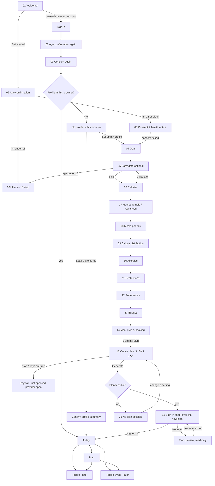

# Screen specs: onboarding, Today, Weekly Plan

## Platform: web (for now)

The Product Owner has switched the first client from iOS to a **mobile-first responsive web app** (phone browser first, then tablet and desktop), installable as a **PWA** for offline use. These specs target that web app. The PRD and DEVELOPMENT_PLAN still describe iOS. Where they conflict, this folder follows the PO's decision, and the conflicts are listed in the open questions.

What changes:

- No SwiftUI, SwiftData, iCloud, Keychain, Share Extension, StoreKit or APNs.
- Accessibility targets WCAG 2.2 AA (semantic HTML, keyboard, focus order, ARIA, browser zoom and font size, `prefers-reduced-motion`, `prefers-color-scheme`). This replaces VoiceOver and Dynamic Type.
- D8 (the health profile stays on the device) becomes "the profile stays in this browser", stored in IndexedDB with no server copy.
- Offline comes from a service worker and a local cache.

What stays reusable if iOS returns:

- All flows, content hierarchy, validation ranges, copy tables (EN/PL), state rules, API needs and metrics.
- The design-system components and tokens. The React bundle `window.Donut` is the web implementation, and each component already maps 1:1 to a SwiftUI view with the same name.
- Only these sections would need an iOS pass: §Where data lives, §Offline, the a11y notes, the Sign-in provider and the reminder permission.

| File | Covers |
|---|---|
| [onboarding.md](onboarding.md) | Welcome → Age confirmation → Consent & health notice → Goal → Body data → Calories → Macros → Meals per day → Distribution → Allergies → Restrictions → Preferences → Budget → Meal prep → Sign-in |
| [today.md](today.md) | Today: day totals, meal cards, meal status, prep labels, empty and offline states |
| [weekly-plan.md](weekly-plan.md) | Plan: create plan, week view, prep groups, variety notice, "No plan possible" |

Recipe, Recipe Swap, Ingredient Swap, Rebalance proposal, Paywall, Profile and Import get their own specs later. This set only defines their **entry points**. The Paywall is deliberately not specified yet because the payment provider is still open (question 3).

Sources: `docs/PRD.md` §4, §5, §7, §8.5–8.7, §8.11, §10, §11, §12, §14 · `docs/DEVELOPMENT_PLAN.md` §3, §7.1, D8, D9, S4/S5 · `design/design-system/` · `backend/app/planner` (`inputs.py`, `result.py`, `report.py`) · `backend/app/users` (consent types) · `backend/app/nutrition/allergens.py`.

---

## Conventions

- **Components and tokens** are named exactly as in `design/design-system/` (`Button`, `SelectCard`, `NumberField`, `ExclusionRow`, `DistributionEditor`, `MealCard`, `DayStrip`, `MacroRing`, `MacroBar`, `MacroLine`, `Delta`, `Notice`, `Badge`, `NavBar`, `OnboardingProgress`, `TabBar`, `BottomAccessory`, `SegmentedControl`, `Toggle`, `Chip`, `Checkbox`, `Avatar`, `StatTile`, `SectionHeader`; tokens such as `surface`, `basil`, `paprika-soft`, `danger`, `space-5`, `radius-lg`, `size-tap`). There are no raw colour or size values in these specs.
- **Navigation on web:** `TabBar` is the bottom nav on `sm`. On `md` and up it becomes a left rail. The Add button stays in the bar or rail, and `Avatar` opens Profile. Each tab and onboarding step has its own URL (`/today`, `/plan`, `/plan/new`, `/onboarding/calories` …), so Back, refresh and deep links work.
- **Copy keys** use the form `screen.element[.variant]`. Every key has EN and PL. PL is primary: allow about 30% more length and use ICU plurals (`one` / `few` / `many` / `other`). Write numbers as digits, a space and the unit. PL uses *1200 kcal* and a decimal comma. EN uses *1,200 kcal*. Language follows `navigator.language` (PL if it starts with `pl`, otherwise EN), and there is a switcher in Profile.
- **Tone** follows the brand book: sentence case, verbs that name the outcome, no *OK* or *Submit*, no emoji, no AI lead, never moralise food or bodies, no medical claims. Polish copy avoids gendered past-tense forms (question 9).
- **Severity colours:** `danger` is only for ALLERGY. `warning` is for INTOLERANCE, missed targets and No plan possible. `info` is for relaxed soft goals. `offline` is for connection notices and general notices.

### Breakpoints

| Name | Width (CSS px) | Shell |
|---|---|---|
| `sm` | < 600 | Single column, bottom `TabBar` with Add, sticky bottom CTA in onboarding, gutter `space-5` |
| `md` | 600–1023 | Left nav rail, content max 720 px centred, two-column card grids where noted |
| `lg` | ≥ 1024 | Left rail, content max 1200 px, a right rail for secondary panels (Today and Plan), Weekly Plan as a week grid |

Onboarding uses a single centred column (max 560 px) at every breakpoint. On `md`/`lg` the primary button sits at the end of the form instead of sticking to the bottom.

### Accessibility baseline (WCAG 2.2 AA), applies to every screen

- Use semantic HTML first: `<main>`, `<nav>`, `<h1>` per page (the screen title), `<button>` for actions, `<a>` for navigation, `<fieldset>` + `<legend>` for each onboarding question, and `<label>` on every input. ARIA only where HTML has no equivalent (tabs, live regions).
- Everything works by keyboard. Focus order follows the visual order. Focus is always visible (`focus-ring`, 2.4.11/2.4.13), and nothing sticky hides the focused element (2.4.11, so sticky CTAs add scroll padding). Dialogs trap focus, close on `Esc` and return focus to the button that opened them.
- On route change, focus moves to the new page's `<h1>` and the document `title` updates (*Calories · Donut*).
- Targets are at least 24×24 CSS px (2.5.8). We use `size-tap` 44 px for all primary controls anyway.
- Text sizes use `rem` and respect the browser's font size. The layout holds at 200% zoom and reflows at 320 px width without horizontal scroll (1.4.10). The only exception is the Weekly Plan desktop table, which falls back to the `sm` layout.
- Colour is never the only signal. Every status and tier also has text. Contrast comes from the tokens (≥ 4.5:1 text, ≥ 3:1 UI).
- Validation errors are linked with `aria-describedby`, the field gets `aria-invalid`, and the message is announced (`role="alert"` on submit, polite live region while typing). Disabled primaries use `aria-disabled` and stay focusable, with the reason in their description.
- `prefers-reduced-motion`: no count-up or morph animations. `prefers-color-scheme`: light/dark tokens, with a manual override in Profile. `prefers-reduced-transparency` / `prefers-contrast`: glass falls back to solid `surface-raised` with a `line-strong` edge (already in `bundle.css`).
- Screen-reader labels for numbers always name the macro (*Protein 84 of at least 115 grams*).

### Metrics, not analytics events

There is **no analytics SDK and no device identifier** (D9, PRD §4, §12.2). On web that also means no third-party analytics scripts and no tracking cookies, so we need no cookie banner (only strictly necessary storage). The "Metric" line on each screen names the PRD §4 metric and the **server record** it comes from. Where no server record exists, which is true of most onboarding steps because the profile stays in the browser, it says "not measured" (question 4).

### Where data lives

| Label in specs | Meaning (web) |
|---|---|
| **Browser (profile)** | `NutritionProfile` in **IndexedDB** for this site in this browser. There is no server copy (D8). It is sent with each plan, transform, swap and rebalance request and not kept by the server. It is not synced between devices or browsers (question 2). |
| **Browser (app state)** | Non-health local state: onboarding position, language, theme, pending consents before sign-in, the offline queue. |
| **Server (consent record)** | `POST /v1/me/consents` `{type, version, granted}` for `age_18_plus`, `health_data`, `terms_of_use`, `privacy_policy`. This needs an account, so answers given before sign-in are held as pending in Browser (app state) and sent right after sign-in. |
| **Server (account data)** | Account, plans, meal status, recipes and shopping list, hosted in the EU. |

What the user is told (onboarding step 03, the Profile › *Where your data lives* page, and the No-profile state):

- *Your profile is saved in this browser on this device. We receive it only to build a plan or swap, and don't keep it.*
- *If you clear this site's data, use private browsing, or switch browser or device, your profile won't be there. Download a copy to keep it safe.*
- **Profile export/import:** in Profile (and offered once after the first plan), *Download my profile* saves a JSON file (`donut-profile-YYYY-MM-DD.json`, no account data inside) and *Load a profile file* restores it. On load, the app shows a summary (calories, protein, exclusions with tiers) that the user must confirm, the same pattern as the iOS *Restore profile* screen. The file holds health data, and the download dialog says so: *This file contains your allergies and targets. Keep it private.*
- **Storage durability:** after the first plan, call `navigator.storage.persist()`. If the browser refuses, show a quiet `offline`-tone notice once: *Your browser may clear stored data when space runs low. Download a copy of your profile to be safe.*
- **Private browsing / storage unavailable:** if IndexedDB can't be opened, onboarding stops at step 03 with `warning` *This browser isn't saving data, so we can't keep your profile. Try a normal (not private) window.*

---

## Shared states

All of these use `Notice` and shared copy.

### Loading

- With cached data, render the cache immediately. Never put a spinner over content that is already available.
- Plan generation (p95 < 2 s): the button shows *Building your plan…* and is disabled. After 8 s, add the slow line. A planner timeout returns the `timeout` blocker (weekly-plan.md).
- Skeletons (`surface-sunken`) appear only without a cache. They have `aria-busy="true"` on the region and one polite announcement, *Loading your plan*.

### Offline (PRD §10), installable PWA

- **PWA:** web app manifest (name, icons, `display: standalone`, theme colours from tokens) and a service worker. *Install* is offered once, in an `offline`-tone notice after the first plan (*Add Donut to your home screen to use your plan offline*). On iOS Safari, which has no install prompt, the notice shows the Share → *Add to Home Screen* steps instead.
- **Cached for offline:** the app shell, the active plan, recipes in the plan, saved recipes and the shopping list (shopping is specified later). Data lives in IndexedDB and the shell in Cache Storage.
- **Works offline:** reading Today, Plan, recipes and the shopping list; marking meals cooked, eaten or skipped; shopping checkmarks. These go into an outbox in IndexedDB and are sent on reconnect (`online` event, plus Background Sync where supported, with a retry on next app open everywhere).
- **Needs a connection:** plan generation, swaps, rebalancing, imports, sign-in, sending consents, free-text exclusion matching. These buttons stay visible. When tapped, an inline `offline` notice names the action. Nothing fails silently.
- An `offline` banner sits at the top of the tab while the browser is offline (`navigator.onLine` plus a failed fetch).
- Queued status changes show a `clock` icon on the status pill (accessible name *Saved on this device, will sync*).
- Conflicts follow the PRD: eaten beats a server-side change to that slot, and any rebalance proposal is shown on next sync for the user to confirm.
- Without installing, the cache still works in an open tab. Browsers may evict non-installed site data sooner, which is another reason for the profile download.

### Error

- Recoverable: `warning` notice saying what failed in plain words, with *Try again*. No raw codes.
- Validation: inline on the field, with the reason. The primary button stays disabled.
- Expired session: refresh silently. If that fails, show the Sign-in sheet with *Sign in again to keep your plan in sync.* Local data is not cleared.

### Empty

- No plan yet: see today.md and weekly-plan.md.
- **No profile in this browser** (new device or browser, cleared data): plans load from the account, but planning, swaps and the import allergen check are paused. `warning` notice with *Set up my profile* (goes to onboarding step 04) and *Load a profile file*.

| Key | EN | PL |
|---|---|---|
| `state.loading.plan` | Building your plan… | Układamy Twój plan… |
| `state.loading.slow` | Still working, this can take a few more seconds. | Jeszcze chwila, to może potrwać kilka sekund dłużej. |
| `state.offline.banner` | You're offline. Your plan and meal check-offs still work. | Jesteś offline. Plan i odhaczanie posiłków nadal działają. |
| `state.offline.action.swap` | Swapping needs a connection. Try again when you're back online. | Zamiana wymaga połączenia z internetem. Spróbuj ponownie, gdy wrócisz online. |
| `state.offline.action.generate` | Building a plan needs a connection. Try again when you're back online. | Ułożenie planu wymaga połączenia z internetem. Spróbuj ponownie, gdy wrócisz online. |
| `state.offline.queued_a11y` | Saved on this device, will sync | Zapisano na tym urządzeniu, zsynchronizuje się później |
| `state.install.title` | Use your plan offline | Korzystaj z planu offline |
| `state.install.body` | Add Donut to your home screen to use your plan without a connection. | Dodaj Donut do ekranu początkowego, aby korzystać z planu bez internetu. |
| `state.install.cta` | Install Donut | Zainstaluj Donut |
| `state.install.ios_steps` | In Safari, tap Share, then Add to Home Screen. | W Safari stuknij Udostępnij, a potem Do ekranu początkowego. |
| `state.error.generic` | Something went wrong on our side. Your data in this browser is safe. | Coś poszło nie tak po naszej stronie. Twoje dane w tej przeglądarce są bezpieczne. |
| `state.error.retry` | Try again | Spróbuj ponownie |
| `state.session.expired` | Sign in again to keep your plan in sync. | Zaloguj się ponownie, aby plan się synchronizował. |
| `state.no_profile.title` | Set up your profile to plan and swap | Uzupełnij profil, aby planować i zamieniać posiłki |
| `state.no_profile.body` | Your profile isn't in this browser. Your allergies need to be here before we can check recipes. | Twojego profilu nie ma w tej przeglądarce. Alergie muszą tu być, zanim sprawdzimy przepisy. |
| `state.no_profile.setup` | Set up my profile | Uzupełnij profil |
| `state.no_profile.load` | Load a profile file | Wczytaj plik profilu |
| `data.where` | Your profile is saved in this browser on this device. We receive it only to build a plan or swap, and don't keep it. | Twój profil jest zapisany w tej przeglądarce na tym urządzeniu. Otrzymujemy go tylko, by ułożyć plan lub zamianę, i go nie przechowujemy. |
| `data.loss_warning` | If you clear this site's data, use private browsing, or switch browser or device, your profile won't be there. Download a copy to keep it safe. | Jeśli wyczyścisz dane tej witryny, użyjesz trybu prywatnego albo zmienisz przeglądarkę lub urządzenie, profilu tam nie będzie. Pobierz kopię, aby go nie stracić. |
| `data.download` | Download my profile | Pobierz mój profil |
| `data.download_warning` | This file contains your allergies and targets. Keep it private. | Ten plik zawiera Twoje alergie i cele. Nie udostępniaj go. |
| `data.load` | Load a profile file | Wczytaj plik profilu |
| `data.load_confirm` | Use this profile? | Użyć tego profilu? |
| `data.persist_refused` | Your browser may clear stored data when space runs low. Download a copy of your profile to be safe. | Przeglądarka może usunąć zapisane dane, gdy zabraknie miejsca. Pobierz kopię profilu na wszelki wypadek. |
| `data.no_storage` | This browser isn't saving data, so we can't keep your profile. Try a normal (not private) window. | Ta przeglądarka nie zapisuje danych, więc nie możemy zachować profilu. Otwórz zwykłe (nie prywatne) okno. |

---

## Navigation map

Onboarding Back (the in-page back button or the browser Back) returns to the previous step with all answers kept. You can't skip past steps 02 and 03 by changing the URL: the router redirects to the first incomplete required step.

---

## API needs (for `backend-engineer`; client architecture for `mobile-architect`, now the web client owner)

1. **Plan response**, per meal: `day`, `slot_id`, `slot`, `recipe_id`, localized recipe title, `portion`, `nutrition` (kcal, P, C, F), `cook_day`, `eat_by_day`, `from_batch`, `leave_out` with display names, `labels` as **structured** `{category, term?, severity, relaxed}` rather than plain strings, and `status`. Per plan: `start_date`, `days`, unique-ingredient count.
2. **Relaxed goals** as codes with parameters (`relaxed: ["variety"]`), not only English `notices`.
3. **Infeasibility report** with structured blocker fields: `kind`, `meal` and `meal_type`, and for `filtered` the reasons (exclusion categories/terms, `max_minutes`, missing equipment). For `kcal` / `protein` / `kcal_and_protein`: `lo`, `hi`, `protein_g`, `day_lo`, `day_hi`, `weak_meal_type`. Suggestion `action` + `value` codes stay stable, as OpenAPI enums. The English `message` remains as a fallback only.
4. **Meal status** endpoint that accepts queued offline events `{slot_id, status, recipe_variant_id, client_timestamp, idempotency_key}`, plus a sync response that can carry a server-proposed rebalance.
5. **Profile snapshot** fields the planner `Profile` lacks: `budget_tier` (`economy`/`standard`/`flexible`) and `preferences[]`. Equipment slugs to agree on (proposed: `air_fryer`, `oven`, `blender`, `microwave`, `thermomix`).
6. **Consents:** `POST /v1/me/consents` exists. The client sends the pending answers in one call after sign-in. Consent text `version` strings must be published with the legal texts.
7. **Anonymous plan generation**, if "plan before sign-in" is kept (question 1): an unauthenticated, rate-limited plan endpoint (per IP, or per short-lived guest token, with no device identifier).
8. **Web auth:** `POST /v1/auth/apple` currently expects the native flow. Sign in with Apple JS needs a Services ID, a registered return URL and the web `id_token` validated against the Services ID audience. Web token storage also needs a decision: the refresh token in an `HttpOnly`, `Secure`, `SameSite=Strict` cookie, not `localStorage`.
9. **CORS / CSP** for the web origin. No third-party scripts except Apple JS (and the payment provider later).

---

## Open questions for the Product Owner

1. **Plan before or after sign-in?** (PRD §15.) These specs assume value first: the plan is generated, then the sign-in sheet covers it, and *Not now* leaves a read-only preview. This needs API need 7. The alternative is to sign in when the user taps *Build my plan*. Which one?
2. **Profile sync across devices and browsers.** D8 on web means the profile exists in one browser only. The specs give a manual download/load file. Options: (a) keep manual only; (b) end-to-end-encrypted sync, where the server stores a blob it can't read, which needs a DPIA review against D8; (c) accept re-entry on each device. Which one, and is the profile file acceptable to the data-protection review?
3. **Payment provider for the web paywall** (Stripe or another). This affects price display, VAT, trial terms, the *Restore purchases* equivalent ("I already paid"), terms links and cancellation. The paywall is not specified until this is decided.
4. **Sign-in providers.** The specs keep Sign in with Apple (Apple JS). On web, many Android/Windows users have no Apple ID. Add Google, an email magic link, or both? This affects the Sign-in sheet layout and backend auth.
5. **Plan reminder on web.** The PRD's Thursday reminder uses iOS notifications. On web it would need Web Push (VAPID, a service worker, and on iOS only for an installed PWA, iOS 16.4+) or an email. The specs show the card only where Web Push is supported. Keep it, switch to email (which needs an email address, while Apple relay is possible), or drop it for now?
6. **Terms of use and privacy acceptance.** Should the sign-in sheet record `terms_of_use` and `privacy_policy` with "By continuing you accept…" link text, or does legal want an explicit tick? The specs assume link text, kept separate from the health-data checkbox.
7. **Order: Allergies before Restrictions.** The PRD lists "Restrictions · Allergies". The design system and these specs put the 14 EU allergens first because they are safety-critical. Confirm.
8. **Onboarding funnel visibility.** With no analytics, only "consent recorded" and "first plan generated" can be measured. Is that enough, or should usability sessions cover drop-off?
9. **Gender-neutral Polish.** The specs avoid gendered past-tense forms (*Zjedzone*, *Ile ruchu masz na co dzień?*) and use a split form (*miałeś/-aś*) in one legal sentence. Confirm that we never ask for or infer gender for grammar.
10. **Macro presets** need dietitian sign-off. Protein share of kcal: Standard 20%, Balanced 25%, High protein 30%, Lower carb 30% (with carbs at 25%). Protein is planned as a minimum, and fat and carbs are soft.
11. **Upper limits the backend doesn't enforce:** 5000 kcal ceiling, protein 0–400 g, fat 0–300 g, carbs 0–800 g, plus the body-data ranges in onboarding.md. Confirm.
12. **Undoing *Eaten* / *Skipped*.** The PRD says these lock the meal. Proposal: *Undo* for 10 s, then *Mark as not eaten* from the card menu on the same day only, which lifts the lock. Allowed?
13. **Free users on Create plan:** show 5 and 7 days locked with a *Standard* tag that opens the paywall, or hide them until later?
14. **Sex options** for the energy equation: *Female*, *Male*, *Prefer not to say* (which skips the calculation). OK?
15. **DEVELOPMENT_PLAN and PRD updates.** S4/S5 iOS deliverables, D8 wording ("on the phone / iCloud"), §12.2 and the brand book's "where data lives" copy all describe iOS. Who updates them, and is the web switch recorded as a decision (D-number)?
