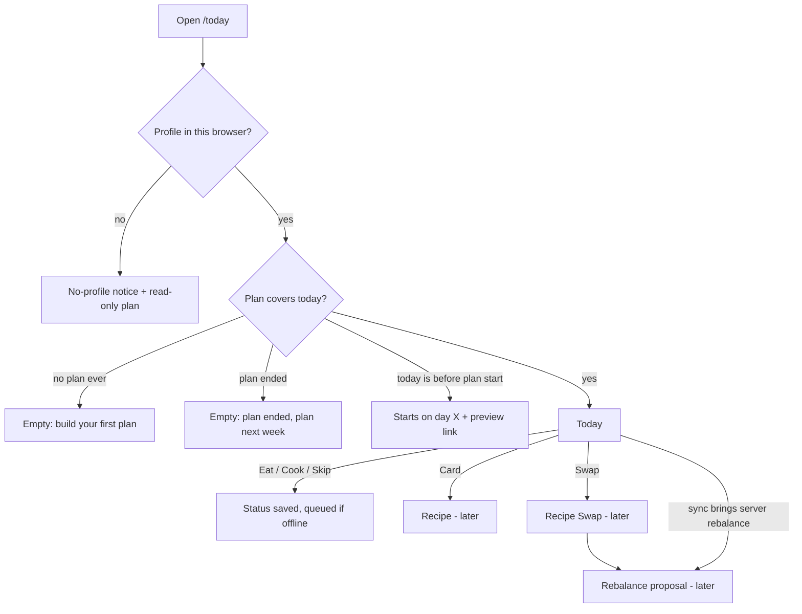

# Today

Platform: mobile-first responsive web / PWA (README §Platform). Route `/today`. The README accessibility baseline (WCAG 2.2 AA) applies.

## Problem and requirement

On a normal day the user needs one place that answers "what do I eat next, how am I doing, and what do I cook today", and lets them record what they ate in one tap, even offline. Serves PRD §4 (North Star: meals marked eaten; Activation: first plan day completed), §8.6 (Swap entry), §8.7 (prep labels), §8.11 (meal status), §10 (offline), §14 DoD 12.

## Flow

1. App opens on Today (tab root) when a profile and a plan exist.
2. Cached plan from IndexedDB renders immediately (service worker serves the shell offline); a background sync updates statuses and pulls any server-proposed rebalance.
3. User taps *Eat* on a meal → status `eaten`, card locks, totals update, event queued/sent.
4. Optional: the card's `…` menu (also right-click / long-press as a shortcut, never the only way) → *Mark as cooked* / *Skip* / *Swap* / *Open recipe*.
5. Tapping the card body → Recipe (later spec). *Swap* → Recipe Swap sheet (later spec), then a Rebalance proposal if needed (later spec).

## Layout

Ground `surface`. Top to bottom:

1. **`NavBar large`**: title *Today*; subtitle weekday + date + plan day (*Wed, 14 Oct · Day 3 of 7*); `Avatar` top right (opens Profile sheet).
2. **Notices zone** (only when present, stacked, never collapsed): offline (`offline`), server-proposed rebalance waiting (`info`, action *Review*), settings changed since plan (`info`, *Build a new plan*), no profile in this browser (`warning`, from README), install prompt once (`offline` tone, `state.install.*`).
3. **Day summary card** (`surface-raised`, `radius-lg`, padding `space-4`):
   - `MacroRing` left: `value` = kcal of meals marked **eaten**, `target` = daily kcal target; centre label `numeral` eaten kcal and `footnote` *of 1,500 kcal*.
   - Right: `MacroBar` protein (`mode="min"`, target = protein minimum), `MacroBar` carbs, `MacroBar` fat (`compact`). Values = eaten grams.
   - Under both: `footnote` *Planned today: 1,512 kcal · 118 P · 150 C · 52 F* (always shown, so the user sees the plan is on target, not only progress).
   - The ring never turns `danger`. Over target by > 3% → arc `warning` per the component; copy stays neutral (no "too much").
4. **Cook today strip** (only if a batch is cooked today): `SectionHeader` *Cook today* + one row per batch recipe: *Chicken curry · 3 portions · covers Wed, Thu, Fri*. Tapping → Recipe.
5. **Meals**: `SectionHeader` *Meals*; one `MealCard` per slot in slot order (see below).
6. Bottom space so the last card scrolls above the `TabBar` and `BottomAccessory`.
7. **`BottomAccessory`**: *Up next · Lunch* (the first meal still `planned` or `cooked`), tap scrolls to that card. When all meals are done: *All meals checked off today*.
8. Floating glass **`TabBar`** (Today selected · Plan · Shopping) + paprika Add button (opens Add Recipe, later spec).

### Breakpoints

| Breakpoint | Layout |
|---|---|
| `sm` < 600 px | As above: single column; bottom `TabBar` + Add; `BottomAccessory` floats above the tab bar. |
| `md` 600–1023 px | Left nav rail replaces the bottom bar. Day summary card full width (ring left, bars right). Cook today strip under it. `MealCard`s in a 2-column grid (slot order reads left→right, top→bottom; DOM order = slot order). `BottomAccessory` becomes an inline row above Meals. |
| `lg` ≥ 1024 px | Left rail; main column (max 720 px) with the Meals list in one column; **right rail (320 px, sticky)** holds the day summary card, Cook today and the Up next row. Notices span the main column. |

## MealCard on Today

Props used: `slot`, `title`, `kcal`, `protein`, `carbs`, `fat`, `status`, `prep`, `badges`, `swappable`, `actions`.

- **Header:** slot name (*Lunch*), portion if not 1 serving (*1.5 portions*).
- **Title:** recipe title (Donut's own title; imported recipes use the user's saved title, never source photos).
- **`MacroLine`:** *520 kcal · 44 P · 52 C · 12 F*.
- **Badges** (in this order, max 3 visible + *+N* that expands inline, never hiding allergy-relevant badges):
  1. Relaxed intolerance label (`warning`, icon `alert`): *Contains lactose · avoid when possible*. From plan `labels` where severity = intolerance and relaxed = true. **Always visible, never in the +N overflow.**
  2. Meal prep (`paprika`, icon `repeat`): see prep states below.
  3. Dislike / prefer-not label (`neutral`): *Has mushrooms (you don't like it)* — only for recipes the user imported or picked, since the planner penalises these.
  4. Leave-out note (`neutral`): *Without walnuts (optional)* from `leave_out`.
  5. *Cooked* (`basil`) when status is `cooked`.
- **Actions row:** primary pill *Eat* (basil); secondary `IconButton`s *Swap* (`swap`), `…` menu (Mark as cooked, Skip, Open recipe). At accessibility sizes the row wraps under the macros.

### Status states

| Status | Card | Pill | Swap | Menu |
|---|---|---|---|---|
| `planned` | normal | *Eat* | visible | Mark as cooked · Skip · Open recipe |
| `cooked` | *Cooked* badge | *Eat* | visible | Skip · Open recipe |
| `eaten` | content at full contrast, check icon, lock | *Eaten* + `lock` | **hidden** | Open recipe · *Mark as not eaten* (see README open question 12) |
| `skipped` | title `ink-muted`, macros struck from totals | *Skipped* + `lock` | **hidden** | Open recipe · *Mark as not skipped* (open question 12) |

- One tap on *Eat* sets `eaten`. A toast (`Notice`-styled, bottom, above the accessory) *Lunch marked as eaten* with *Undo* for 10 s.
- Eaten meals are never changed by swaps or rebalances; Rebalance proposals show them as locked (later spec).
- Earlier slots still `planned` after their usual time are **not** auto-marked and not nagged. No red or guilt colouring.
- Totals count up over about 250 ms (`prefers-reduced-motion`: no animation).

### Meal-prep display

From plan fields `from_batch`, `cook_day`, `eat_by_day` (day indexes mapped to weekdays via plan `start_date`).

| Case | Badge | Extra |
|---|---|---|
| Cooked today, covers later days | *Cook today · eat by Fri* | Listed in Cook today strip |
| Eaten from a batch cooked earlier | *Cooked Mon · eat by Wed* | — |
| Last day of a batch (eat_by = today) | *Cooked Mon · eat by today* | `footnote` under title: *Last portion from Monday's batch.* |
| Not batched | *Prepare fresh* (neutral) | Only shown when `prep_days > 1` so single-day cooks don't see noise |

`MealCard prep` = `{portion: '1/3', cook: 'Mon', eatBy: 'Wed'}` where portion = position in the batch.

## States

- **Loading:** cache first. Without a cache (fresh install after restore), skeletons for the summary card and three `MealCard`s.
- **Offline:** README banner. *Eat* / *Mark as cooked* / *Skip* work and show the queued `clock` icon. *Swap* tapped → inline `state.offline.action.swap`. Plan regeneration hidden behind the same message.
- **Sync conflict (eaten beats plan change):** if the server had swapped a slot the user marked eaten offline, the card shows the recipe the user actually ate and an `info` notice appears: *We kept the lunch you ate. Review a proposal for the rest of today?* → Rebalance proposal.
- **Error marking status online:** status stays applied locally and is queued (same as offline). No error shown unless retries fail for 24 h; then `warning` *Some check-offs haven't synced yet.* with *Try again*.

### Empty states

| Case | Content | Primary |
|---|---|---|
| No plan yet (after sign-in, plan deleted, or onboarding finished without a plan) | `display` *No plan yet*; `body` *Build a plan and Today will show what to eat and cook.* | *Build my plan* → Create plan |
| Plan ended | *Your plan ended on {weekday}.* `body` *Plan the next days so you have a shopping list ready.* | *Plan next days* → Create plan |
| Plan starts later | *Your plan starts {weekday}.* | *See the plan* → Plan tab |
| No profile in this browser | README no-profile notice above a read-only plan (status changes still allowed, swaps disabled) | *Set up my profile* |

## Entry points to later specs

| From | Action | Goes to |
|---|---|---|
| `MealCard` body, Cook today row, `…` → Open recipe | tap | Recipe (later) with the planned variant and portion |
| `MealCard` *Swap* | tap | Recipe Swap sheet (later); payload: plan id, slot id, day |
| Notice *Review* | tap | Rebalance proposal (later) |
| `Avatar` | tap | Profile sheet (later) |
| Add button | tap | Add Recipe (later) |

## Copy

| Key | EN | PL |
|---|---|---|
| `today.title` | Today | Dzisiaj |
| `today.subtitle` | {date} · Day {n} of {total} | {date} · Dzień {n} z {total} |
| `today.ring.of` | of {kcal} kcal | z {kcal} kcal |
| `today.planned_line` | Planned today: {kcal} kcal · {p} P · {c} C · {f} F | Plan na dziś: {kcal} kcal · {p} B · {c} W · {f} T |
| `today.cook_today` | Cook today | Ugotuj dzisiaj |
| `today.cook_row` | {portions, plural, one {# portion} other {# portions}} · covers {days} | {portions, plural, one {# porcja} few {# porcje} many {# porcji} other {# porcji}} · na {days} |
| `today.meals` | Meals | Posiłki |
| `today.up_next` | Up next · {slot} | Następny · {slot} |
| `today.all_done` | All meals checked off today | Wszystkie dzisiejsze posiłki odhaczone |
| `meal.action.eat` | Eat | Zjedz |
| `meal.status.eaten` | Eaten | Zjedzone |
| `meal.status.skipped` | Skipped | Pominięte |
| `meal.status.cooked` | Cooked | Ugotowane |
| `meal.action.cooked` | Mark as cooked | Oznacz jako ugotowane |
| `meal.action.skip` | Skip | Pomiń |
| `meal.action.swap` | Swap | Zamień |
| `meal.action.recipe` | Open recipe | Otwórz przepis |
| `meal.action.unmark_eaten` | Mark as not eaten | Oznacz jako niezjedzone |
| `meal.action.unmark_skipped` | Mark as not skipped | Cofnij pominięcie |
| `meal.toast.eaten` | {slot} marked as eaten | {slot}: oznaczono jako zjedzone |
| `meal.toast.undo` | Undo | Cofnij |
| `meal.portions` | {n} portions | {n} porcji |
| `meal.label.relaxed` | Contains {item} · avoid when possible | Zawiera: {item} · unikaj, gdy to możliwe |
| `meal.label.dislike` | Has {item} (you don't like it) | Zawiera: {item} (nie lubisz) |
| `meal.label.leave_out` | Without {item} (optional) | Bez: {item} (opcjonalny składnik) |
| `prep.cook_today` | Cook today · eat by {day} | Ugotuj dziś · zjedz do: {day} |
| `prep.cooked_on` | Cooked {day} · eat by {eat_by} | Ugotowane: {day} · zjedz do: {eat_by} |
| `prep.eat_by_today` | Cooked {day} · eat by today | Ugotowane: {day} · zjedz dzisiaj |
| `prep.last_portion` | Last portion from {day}'s batch. | Ostatnia porcja z partii ugotowanej w: {day}. |
| `prep.fresh` | Prepare fresh | Przygotuj na świeżo |
| `today.conflict` | We kept the {slot} you ate. Review a proposal for the rest of today? | Zachowaliśmy zjedzony posiłek ({slot}). Sprawdzić propozycję na resztę dnia? |
| `today.review` | Review | Sprawdź |
| `today.settings_changed` | Your settings changed. Build a new plan? | Twoje ustawienia się zmieniły. Ułożyć nowy plan? |
| `today.sync_stuck` | Some check-offs haven't synced yet. | Część odhaczonych posiłków jeszcze się nie zsynchronizowała. |
| `today.empty.title` | No plan yet | Nie masz jeszcze planu |
| `today.empty.body` | Build a plan and Today will show what to eat and cook. | Ułóż plan, a tutaj zobaczysz, co jeść i gotować. |
| `today.empty.cta` | Build my plan | Ułóż mój plan |
| `today.ended.title` | Your plan ended on {weekday}. | Twój plan zakończył się: {weekday}. |
| `today.ended.body` | Plan the next days so you have a shopping list ready. | Zaplanuj kolejne dni, by mieć gotową listę zakupów. |
| `today.ended.cta` | Plan next days | Zaplanuj kolejne dni |
| `today.later.title` | Your plan starts {weekday}. | Twój plan zaczyna się: {weekday}. |
| `today.later.cta` | See the plan | Zobacz plan |

Notes on PL: macro letters in PL are **B · W · T** (białko, węglowodany, tłuszcz), order matches P · C · F. `today.conflict` uses a gender-neutral form. Weekday names in PL with colon pattern (*zjedz do: pt*) avoid declension of day names.

## Accessibility

- `MacroRing` + bars read as one element: *Eaten today 640 of 1,500 kilocalories. Protein 48 of at least 115 grams. Carbs 70 of 150 grams. Fat 20 of 50 grams.*
- Page structure: `<h1>Today</h1>`, notices in a region before the summary, `<section aria-labelledby>` for *Cook today* and *Meals*; meals are an `<ol>` (slot order matters) of `<article>` cards, each headed by `<h2>` slot + title.
- Each `MealCard` has one link (the title → Recipe) and real `<button>`s *Eat*, *Swap*, *More actions* (`aria-haspopup="menu"`, menu with arrow-key navigation, `Esc` closes). Accessible names include the slot: *Eat lunch*, *Swap lunch*. The card is not one giant click target wrapping buttons (no nested interactive elements).
- Macro text is real text: *520 kcal · 44 P · 52 C · 12 F* with an `aria-label` *520 kilocalories, 44 grams protein, 52 grams carbs, 12 grams fat*.
- The *Eat* pill is ≥ 44 × 44 px; on locked cards the pill becomes static text *Eaten* with the lock icon labelled *locked*.
- Status changes announce via a polite live region (*Lunch marked as eaten*). The Undo toast is `role="status"`, stays 10 s, pauses on hover/focus (WCAG 2.2.1), and *Undo* is reachable by keyboard: focus is not moved into the toast, and *Undo* sits in the tab order right after the card.
- Keyboard: Tab order = notices → summary → Cook today → meals in slot order → bottom nav. `BottomAccessory` *Up next* is a skip link to that card.
- Zoom/font size: at 200% zoom or large browser font sizes the summary card stacks ring above bars; ring size caps at `size-ring`; `MacroLine` wraps onto two lines.
- Status is never colour-only: text *Eaten* / *Skipped* plus icon.

## Edge cases

- **Time zones / midnight:** "today" is the device's local date; the plan day changes at local midnight. A meal marked at 00:30 counts for the plan day the user is viewing, which is today unless they navigated from Plan.
- **Planned day totals:** shown as returned (the planner guarantees ±5% and ≥ 1200 kcal). Skipped meals lower the eaten totals only; no message suggests eating more or less.
- **Server-proposed rebalance after conflict** never applies itself; user must review.
- **Same recipe twice in a day:** not possible (planner: at most once a day).
- **Recipe deleted / import removed** while in a plan: card stays with its title and macros; Open recipe shows *This recipe was removed.* (Recipe spec).

## Metrics (PRD §4)

| Metric | Source |
|---|---|
| North Star: meals marked eaten per week | Server meal-status records (`eaten`), aggregated, no health data |
| Retention: meals marked cooked/eaten | Same records (`cooked`, `eaten`) |
| Activation (strong): first plan day completed | First plan day where every slot is eaten or skipped |
| Value: meal swaps / rebalances accepted | Swap and rebalance records (later specs) |
| Meal-prep usage | Plans with batches; meals eaten from a batch (`from_batch`) |

## API needs

See README API needs 1, 4. Today additionally needs: plan `start_date` and `days`, per meal `slot_id`, `status`, `status_updated_at`; a sync endpoint returning statuses changed elsewhere and any pending rebalance proposal id.
