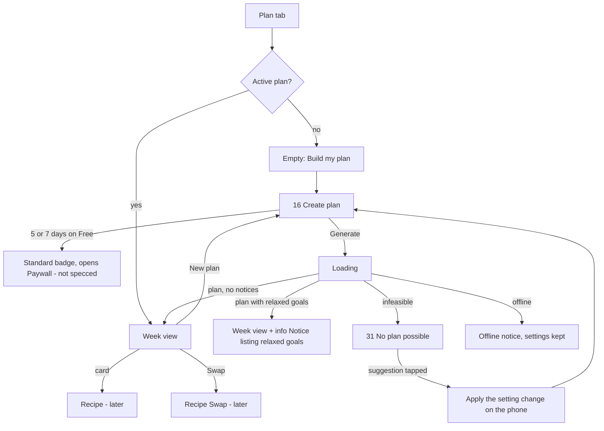

# Weekly Plan

Platform: mobile-first responsive web / PWA (README §Platform). Routes `/plan` and `/plan/new`. The README accessibility baseline (WCAG 2.2 AA) applies.

## Problem and requirement

The user needs to create a plan of 3, 5 or 7 days, see the whole plan at a glance (what to cook when, what is batched, how each day adds up), and understand plainly why a plan couldn't be built or which soft goals were relaxed. Serves PRD §8.5 (planner, tolerances, infeasibility), §8.7 (meal prep), §8.11 (status), §11 (Free 3 days), §14 DoD 3, 8, 12.

Principles: explainability (every relaxed goal and every blocker is listed in plain words), allergies are sacred (never offered for relaxing), meal prep first-class (cook days visible in the strip and on cards), nothing changes without confirmation.

## Flow

1. Plan tab → Create plan (if none) or week view.
2. Create plan: choose length, review a summary of the profile, *Generate*.
3. Result: week view, possibly with a relaxed-goals notice; or the No plan possible screen with actions.
4. Replacing an existing plan asks for confirmation (*Replace your current plan? Meals you've already marked stay in your history.*).

## Breakpoints (web)

See README §Breakpoints. Summary for this screen:

| Breakpoint | Layout |
|---|---|
| `sm` < 600 px (phone) | `DayStrip` at top (horizontal scroll), one day's meals below as a single column of `MealCard`s. |
| `md` 600–1023 px (tablet) | `DayStrip` full width (no scroll for 7 days); day summary and Cook-on-this-day panel side by side; meals in a 2-column grid. |
| `lg` ≥ 1024 px (desktop) | Week grid: one column per day (3, 5 or 7 columns, min 168 px each, horizontal scroll when narrower), rows = meal slots, compact `MealCard`s; day totals in each column header; Cook panel in a right rail (280 px). `DayStrip` hidden (the column headers replace it). |

## 16 Create plan

**Purpose:** choose plan length and start date; generate.

**Layout:** `NavBar` title *New plan*. Sections:
1. *How many days?* `SegmentedControl` *3 days* · *5 days* · *7 days*. Free users: 5 and 7 carry a `Badge premium`-style *Standard* tag (no price here) and selecting them opens the Paywall (not specced now). Default: 3 on Free, 7 on Standard.
2. *Start on* — `Chip`s *Today* · *Tomorrow* · next Monday (*Mon, 19 Oct*). Default: Today before 14:00 local, else Tomorrow.
3. *Your settings* summary (`surface-raised` group, read-only rows with *Edit* links): *1,500 kcal · at least 115 g protein · 3 meals*; *Cook once for 2 days · max 30 min*; *Exclusions: fish (allergy), lactose (intolerance)* — allergies always listed in full here, never truncated; *Budget: Economy*.
4. Sticky primary *Generate {n}-day plan*.

**Request:** the profile snapshot (from browser storage) + `days` + `start_date`. **Validation:** none beyond the profile's own; `days ∈ {3,5,7}`.

**Loading:** button shows `state.loading.plan`; after 8 s `state.loading.slow`. The page stays interactive (Back cancels the request).

## Week view

**Layout (phone, `sm`):**
1. `NavBar large` title *Plan*; subtitle *{start} – {end} · {n} days*; `Avatar` right; text button *New plan* in the nav trailing area.
2. **Notices zone** (stacked, never collapsed): relaxed goals (`info`), offline (`offline`), settings changed (`info`).
3. **`DayStrip`**: `days[] {name, num, state}` where `state` = `done` (all meals eaten/skipped), `prep` (a batch is cooked that day), else `planned`. Selected day = today if inside the plan, else day 1. Arrow keys move between days (roving tabindex).
4. **Day summary** (`surface-raised`): `MacroLine lg` of the day's planned totals *1,512 kcal · 118 P · 150 C · 52 F*, a `Badge basil` *On target* (always true for planner output; shown so users trust the numbers) and a `footnote` *Target 1,500 kcal ± 5% · at least 115 g protein*.
5. **Cook on this day** (only if a batch is cooked on the selected day): rows *Chicken curry · 3 portions · covers Wed, Thu, Fri*.
6. **Meals**: `MealCard` per slot, same props, statuses, badges and actions as on Today (see today.md §MealCard). Status can be set for any day already started or earlier; future days show *Eat* disabled with tooltip/hint *You can check this off on {weekday}.*
7. `BottomAccessory`: *Cook today · {n} recipes* (or hidden when nothing to cook today).
8. Bottom nav (Today · Plan · Shopping + Add).

**Economy summary** (when the plan returns a unique-ingredient count): a single `StatTile` under the day summary *23 unique ingredients this plan*. The Economy comparison (*vs 34*) is Paywall/Economy material, not specced now.

### Meal-prep display

- `DayStrip` marks cook days with the `prep` dot (paprika).
- On each card: *Cook {day} · eat by {day}* / *Cooked {day} · eat by {day}* / *Prepare fresh* (only when `prep_days > 1`), same copy keys as Today.
- Desktop grid: cards in the same batch are connected by a 2 px `paprika` bar along their left edge across columns, plus the text badge (the bar is decorative; the text carries the meaning).
- A batch never spans more days than `prep_days` or the recipe's fridge days (backend guarantee); the UI does not re-check.

### Relaxed-intolerance labels

Any planned meal with a relaxed (*avoid when possible*) intolerance shows the `warning` badge *Contains {item} · avoid when possible* on every view, including the compact desktop card. The day summary adds a line *{n} meals this plan include something you avoid when possible.* linking to a filter that highlights them. Allergy items can never appear (planner hard constraint), so there is no allergy badge in plans.

### Variety and other relaxed-goal notices

When the plan result has `relaxed` rules / `notices`, show at the top a `Notice tone="info"`, title *We relaxed {n} goal(s) to build this plan*, `items` one per rule:

| Rule code | EN item | PL item |
|---|---|---|
| `variety` | Some recipes repeat more often than usual, because few recipes fit your settings. | Niektóre przepisy powtarzają się częściej niż zwykle, bo do Twoich ustawień pasuje niewiele przepisów. |
| other / unknown code | show the server `message` (EN) | show the server `message` and log a missing translation |

Actions: *Keep this plan* (dismisses notice for this plan) and *Change settings* (opens Create plan summary with Edit links). Hard constraints are never in this list (they are never relaxed).

## 31 No plan possible

**Purpose:** explain what blocked the plan and offer tested fixes (PRD §8.5; `backend/app/planner/report.py`).

**Layout:** `NavBar` *New plan*. A `Notice tone="warning"` at the top: title *We couldn't build a {n}-day plan*; `items` = one line per blocker; then `SectionHeader` *You could* and one `Button` (secondary, full width, left-aligned) per suggestion, in the server's order, the first as primary. A text link *Back to settings*. Nothing about relaxing an allergy appears, ever; the server never suggests it, and the client must also drop any suggestion that would (defence in depth).

**Blockers (`Blocker.kind`)** — the app renders text from codes and structured params (README API need 3), not the English `message`:

| kind | Params | EN | PL |
|---|---|---|---|
| `no_recipes` | `meal_type` | There are no {meal_type_plural} to choose from. | Brak przepisów na {meal_type_gen_pl} do wyboru. |
| `filtered` | `meal_type`, `reasons[]` (exclusions list, minutes, missing equipment) | No {meal_type_plural} match {reasons}. | Żadne {meal_type_nom_pl} nie pasują do: {reasons}. |
| `protein` | `protein_g`, `lo`, `hi`, optional `weak_meal_type` | The recipes that fit your settings can't reach {protein_g} g protein a day within {lo}–{hi} kcal. [The {weak_meal_type_plural} that fit are low in protein.] | Przepisy pasujące do Twoich ustawień nie dają {protein_g} g białka dziennie w zakresie {lo}–{hi} kcal. [Pasujące {weak_meal_type_nom_pl} mają mało białka.] |
| `kcal` | `lo`, `hi`, `protein_g`, `day_lo`/`day_hi` | The recipes that fit your settings can't add up to {lo}–{hi} kcal a day with at least {protein_g} g protein. [Even the largest portions add up to only about {day_hi} kcal a day. / Even the smallest portions add up to about {day_lo} kcal a day.] | Przepisy pasujące do Twoich ustawień nie sumują się do {lo}–{hi} kcal dziennie przy co najmniej {protein_g} g białka. [Nawet największe porcje dają tylko ok. {day_hi} kcal dziennie. / Nawet najmniejsze porcje dają ok. {day_lo} kcal dziennie.] |
| `kcal_and_protein` | `lo`, `hi`, `protein_g`, `day_lo`/`day_hi` | The recipes that fit your settings can't reach {lo}–{hi} kcal and {protein_g} g protein a day. | Przepisy pasujące do Twoich ustawień nie dają {lo}–{hi} kcal i {protein_g} g białka dziennie. |
| `timeout` | — | Donut couldn't finish building this plan in time. | Donut nie zdążył ułożyć tego planu. |

`{reasons}` parts, joined with commas and *and* / *i*:

| Reason | EN | PL |
|---|---|---|
| exclusion | your exclusions ({names}) | Twoich wykluczeń ({names}) |
| time | the {minutes}-minute limit | limitu {minutes} minut |
| equipment | your equipment (no {appliances}) | Twojego sprzętu (brak: {appliances}) |

Meal type forms (PL needs several cases):

| meal_type | EN plural | PL nominative plural | PL genitive plural |
|---|---|---|---|
| breakfast | breakfasts | śniadania | śniadań |
| lunch | lunches | obiady | obiadów |
| dinner | dinners | kolacje | kolacji |
| snack | snacks | przekąski | przekąsek |

**Suggestions (`Suggestion.action`, `value`)** — buttons. Tapping applies the change to the **profile in browser storage** (shown as a confirmation first, nothing silent) and returns to Create plan with the new value highlighted:

| action | value | Button EN | Button PL | What happens |
|---|---|---|---|---|
| `max_minutes` | minutes or `null` | Raise max cooking time to {value} min / Remove the cooking time limit | Zwiększ maks. czas gotowania do {value} min / Usuń limit czasu gotowania | Confirm sheet, then update `max_minutes` |
| `add_equipment` | appliance slug | I have a {appliance}, add it | Mam: {appliance} – dodaj | Update equipment |
| `relax_intolerance` | exclusion category | Change {item} to "avoid when possible" | Zmień {item} na „unikaj, gdy to możliwe” | Confirm sheet explaining the tier: *{item} may appear when nothing else fits, always labelled.* Never offered for an allergy. |
| `shorten_plan` | days | Shorten the plan to {value} days | Skróć plan do {value} dni | Set length, regenerate on confirm |
| `lower_protein` | — | Lower my daily protein minimum | Obniż dzienne minimum białka | Open protein field (Profile › Targets) |
| `change_kcal` | — | Adjust my daily calorie target | Zmień dzienny cel kaloryczny | Open calories field (1200 floor still applies) |
| `add_recipes` | meal type or none | Add or import more {meal_type_plural} / Add or import more recipes | Dodaj lub zaimportuj więcej przepisów na {meal_type_gen_pl} / Dodaj lub zaimportuj więcej przepisów | Opens Add Recipe (later spec) |
| `retry` | — | Try again | Spróbuj ponownie | Re-sends the same request |

If a suggestion is offline-only blocked (it needs regeneration), the button stays enabled but shows `state.offline.action.generate` when tapped.

## States

- **Loading:** see Create plan. On the week view, cache first.
- **Offline:** week view fully readable from the cached plan (README §Offline, PWA). Status changes queue. *New plan*, *Swap*, suggestion buttons that regenerate: inline offline notice.
- **Error:** non-planner failure → `state.error.generic` with *Try again*; the previous plan stays active.
- **Empty (no plan):** `display` *No plan yet*; `body` *Pick how many days and we'll build meals that fit your targets and exclusions.*; primary *Build my plan*. If no profile in this browser: the no-profile notice instead (README).

## Copy

| Key | EN | PL |
|---|---|---|
| `plan.title` | Plan | Plan |
| `plan.subtitle` | {start} – {end} · {n} days | {start} – {end} · {n} dni |
| `plan.new` | New plan | Nowy plan |
| `plan.create.title` | New plan | Nowy plan |
| `plan.create.days` | How many days? | Na ile dni? |
| `plan.create.days_value` | {n} days | {n} dni |
| `plan.create.standard_tag` | Standard | Standard |
| `plan.create.start` | Start on | Początek |
| `plan.create.today` | Today | Dzisiaj |
| `plan.create.tomorrow` | Tomorrow | Jutro |
| `plan.create.settings` | Your settings | Twoje ustawienia |
| `plan.create.edit` | Edit | Zmień |
| `plan.create.cta` | Generate {n}-day plan | Ułóż plan na {n} dni |
| `plan.replace.confirm` | Replace your current plan? Meals you've already marked stay in your history. | Zastąpić obecny plan? Odhaczone posiłki zostaną w historii. |
| `plan.replace.yes` | Replace plan | Zastąp plan |
| `plan.on_target` | On target | Zgodnie z celem |
| `plan.target_line` | Target {kcal} kcal ± 5% · at least {p} g protein | Cel {kcal} kcal ± 5% · co najmniej {p} g białka |
| `plan.cook_on_day` | Cook on this day | Gotowanie tego dnia |
| `plan.unique_ingredients` | {n} unique ingredients this plan | {n, plural, one {# składnik} few {# różne składniki} many {# różnych składników} other {# składnika}} w tym planie |
| `plan.future_eat_hint` | You can check this off on {weekday}. | Odhaczysz to w dniu: {weekday}. |
| `plan.relaxed_count` | {n, plural, one {# meal this plan includes} other {# meals this plan include}} something you avoid when possible. | {n, plural, one {# posiłek w tym planie zawiera} few {# posiłki w tym planie zawierają} many {# posiłków w tym planie zawiera} other {# posiłku w tym planie zawiera}} coś, czego unikasz, gdy to możliwe. |
| `plan.relaxed.title` | We relaxed {n, plural, one {# goal} other {# goals}} to build this plan | {n, plural, one {Złagodziliśmy # cel} few {Złagodziliśmy # cele} many {Złagodziliśmy # celów} other {Złagodziliśmy # celu}}, aby ułożyć ten plan |
| `plan.relaxed.keep` | Keep this plan | Zostaw ten plan |
| `plan.relaxed.change` | Change settings | Zmień ustawienia |
| `plan.infeasible.title` | We couldn't build a {n}-day plan | Nie udało się ułożyć planu na {n} dni |
| `plan.infeasible.could` | You could | Co możesz zrobić |
| `plan.infeasible.back` | Back to settings | Wróć do ustawień |
| `plan.relax.confirm` | {item} may appear when nothing else fits, always labelled. Your allergies don't change. | {item} może się pojawić, gdy nic innego nie pasuje – zawsze z oznaczeniem. Twoje alergie się nie zmieniają. |
| `plan.empty.title` | No plan yet | Nie masz jeszcze planu |
| `plan.empty.body` | Pick how many days and we'll build meals that fit your targets and exclusions. | Wybierz liczbę dni, a ułożymy posiłki dopasowane do Twoich celów i wykluczeń. |

PL note: 3, 5 and 7 all take *dni*, so `plan.create.days_value` needs no plural branch for MVP lengths.

## Accessibility (WCAG 2.2 AA)

- `DayStrip` is a `role="tablist"`; each day a `tab` with `aria-selected`, label *Wednesday 14 October, cook day, 2 of 3 meals eaten*; the meals area is the `tabpanel`. Arrow keys move, Home/End jump.
- Desktop grid is a real `<table>` with `<th scope="col">` days and `<th scope="row">` slots, so screen readers announce *Wednesday, Lunch*. The batch connector bar is `aria-hidden`.
- No plan possible: the warning `Notice` is `role="alert"` on first render and receives focus; blockers are a `<ul>`; suggestion buttons follow in DOM order.
- Confirmation sheets are `<dialog>` with focus trapped, `Esc` closes, focus returns to the triggering button.
- Disabled *Eat* on future days uses `aria-disabled="true"` with the hint in `aria-describedby` (stays focusable so the reason is discoverable).
- Works at 200% browser zoom and 320 px CSS width without horizontal scroll (except the desktop table, which falls back to the `sm` layout below 1024 px).

## Edge cases

- **Plan crosses midnight/time zone change:** day labels from `start_date` in the browser's local zone.
- **Profile changed after generation:** the plan stays; `info` notice *Your settings changed. Build a new plan?*
- **Free user with an older 7-day plan after downgrade:** plan stays readable; new plans limited to 3 days.
- **Suggestion would now fail** (user changed something else meanwhile): regeneration may return another infeasible result; show it the same way.
- **Unknown blocker kind or action code** from a newer server: show the server's English `message` and hide the action button rather than guess.
- **Timeout:** show `timeout` text with *Try again* and, for 5/7 days, *Shorten the plan to 3 days*.

## Metrics (PRD §4)

| Metric | Source |
|---|---|
| Activation: first plan generated | Server plan records |
| Retention: plans regenerated week over week | Plan records per account per ISO week |
| Meal-prep usage | Plans with `prep_days > 1` and batches |
| Planner health (internal) | Count of infeasible responses by `kind` and accepted `action` (aggregated, no profile data) |

## API needs

README API needs 1–3. Additionally: plan `start_date`, `days`, unique-ingredient count; a `replace` flag on plan creation; stable `kind`/`action` codes (document them in OpenAPI as enums).
